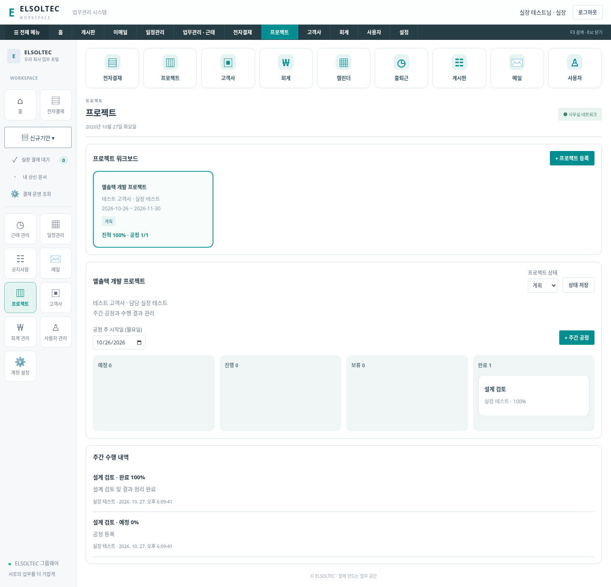
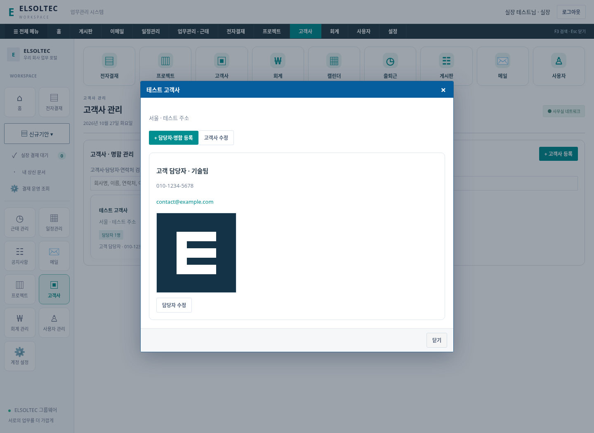
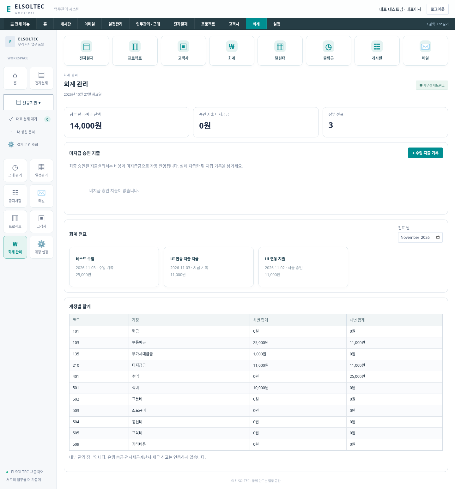
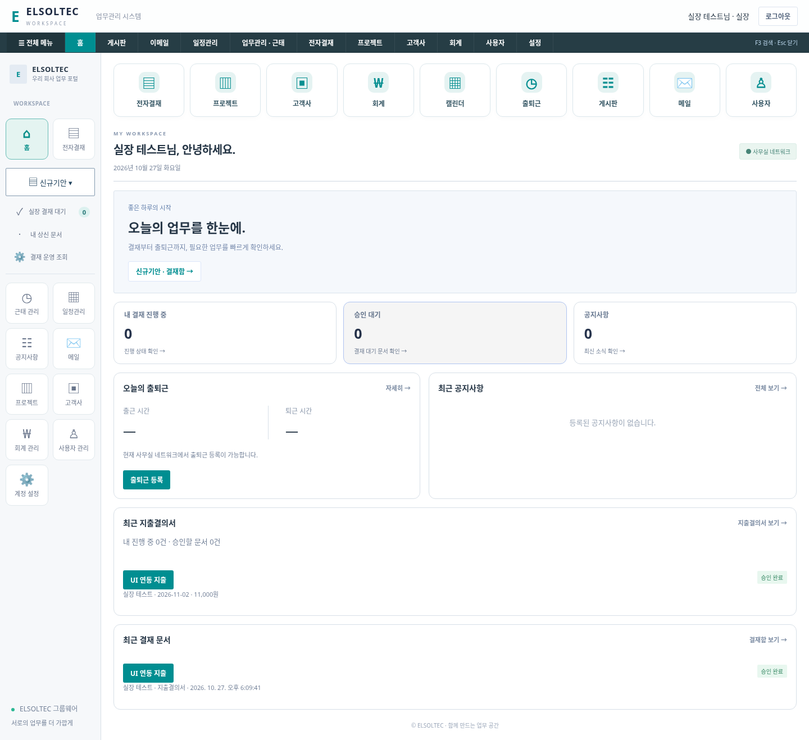
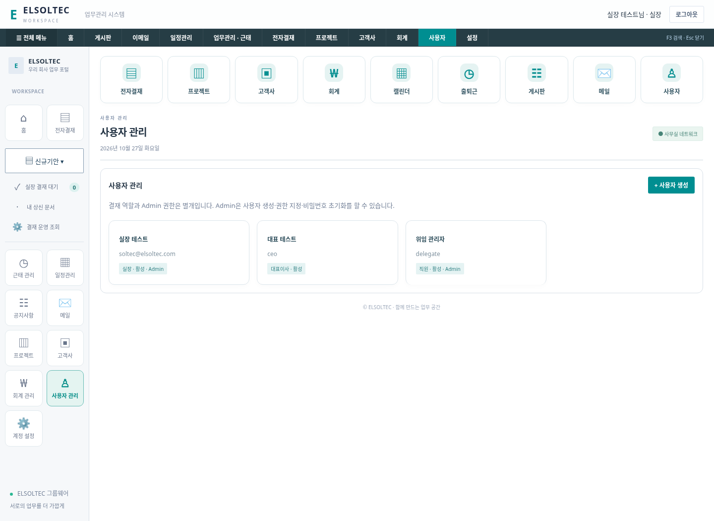

> 최신 권한·사용자 삭제·회계 수정/삭제·개인 메일함 정책은 [권한·메일 관리 안내](ACCESS-MAIL-MANAGEMENT.md)를 따릅니다. 회계는 Admin 단독 권한으로 접근할 수 없습니다.

# ELSOLTEC 업무 보드 · 이번 확장

> 이후 변경: 이사/대표 본인 승인, 프로젝트 전체 사용자 공동 수정, 공정 달력, 일정 공동 수정·프로젝트 연결, 연구개발비 신규 양식 제거가 적용됐습니다. [최신 정책](COLLABORATION-UPDATE.md)을 우선 확인하세요.

> 최신 추가: 사용자 관리에서 개인 프로필 수정과 9개 직급/4개 조직, 일정 참여자 선택을 지원합니다. [사용법](PROFILES-PARTICIPANTS.md)을 확인하세요.
이번 사용자 요청 6개를 반영한 현재 기능과 운영 방법입니다. 과거 영상 분석 문서의 정책 설명보다 이 문서를 우선합니다.

## 1. 실장 본인 상신·승인

실장(manager)은 자신이 상신한 휴가(LV), 지출(EX), 기타 기안(AP)을 실장 결재 대기함에서 승인/반려할 수 있습니다. 서버 권한 검사와 화면 버튼을 함께 변경했습니다. 본인이 작성한 문서도 대기 건수에 들어갑니다.

실장 승인 뒤 대표(ceo) 최종 승인 단계는 기존대로 유지합니다. 실장 본인 승인을 허용한다는 것이 대표 승인까지 자동 완료한다는 뜻은 아닙니다. 대표 자신의 최종 승인은 계속 차단합니다. Admin 권한만 가진 직원에게 결재 권한을 자동 부여하지 않습니다.

## 2. 프로젝트 · 주간 공정

- 프로젝트 이름·고객사·기간·목표를 등록하고 계획/진행/보류/완료 상태로 관리합니다.
- 주 시작일은 **월요일**이며 프로젝트 기간과 겹치는 주를 선택합니다.
- 주간 공정에 담당자를 지정하고 예정/진행/보류/완료 보드에서 확인합니다.
- 담당자는 상태·진척률과 수행 내역을 함께 기록합니다. 완료는 100%, 예정은 0%로 저장합니다.
- 수행 내용과 기록자·시각을 이력으로 보존합니다. 다른 창의 오래된 버전으로 덮어쓰지 못합니다.
- 프로젝트 등록자는 자신의 프로젝트를 관리하며 실장/대표/Admin도 관리할 수 있습니다. 일반 직원은 배정된 공정의 진척·수행 내역을 변경할 수 있습니다.
- 프로젝트 진척은 전체 공정 진척률의 단순 평균입니다. 프로젝트 상태는 담당자가 별도로 변경합니다.

간트 차트·공정 의존성·파일 첨부·드래그 이동·자원/공수 계산은 아직 제공하지 않습니다.

## 3. 고객사 · 명함

회사명·주소·회사 메모와 회사별 여러 담당자를 등록합니다. 담당자마다 이름·직책·전화/휴대폰·이메일·메모·명함 이미지를 보관하며 회사/담당자/연락처로 검색합니다. 이메일 링크는 기기의 메일 앱을 엽니다.

명함은 PNG/JPEG **512KiB 이하** 이미지입니다. DB에 이미지와 텍스트를 보관하며 OCR 자동 인식은 없습니다. 업데이트 시 새 이미지를 선택하지 않으면 기존 이미지를 유지합니다.

고객사/담당자 정보는 로그인한 직원에게 공유됩니다. 변경은 등록자 또는 실장/대표/Admin이 할 수 있습니다. 이미지는 인증된 요청에만 제공하며 원본 DB와 함께 백업합니다.

## 4. 지출결의서와 내부 회계

기본 계정과목과 차변/대변이 균형인 전표를 기록하는 내부 장부입니다.

1. 지출결의서는 대표까지 **최종 승인**되면 비용/부가세대급금 차변과 미지급금 대변으로 한 번만 기록합니다.
2. 미지급 카드에서 실제 지급일·출납 계정을 선택하면 미지급금 차변과 현금/예금 대변을 기록합니다.
3. 같은 지출의 승인 전표와 지급 전표는 각각 중복 생성할 수 없습니다. 실장 승인만 된 문서는 아직 전표가 되지 않습니다.
4. 수입 또는 직접 지출도 금액·일자·출납 계정으로 기록할 수 있습니다. 자동 반영된 승인 지출을 수동 지출로 중복 입력하지 마세요.
5. 월별 전표 카드와 전표별 분개, 계정별 차변/대변 누계를 조회합니다.

장부 현금/예금 잔액은 입력한 기록의 합계이며 은행 실잔액이 아닙니다. 초기값은 0입니다. 기존 승인 지출도 첫 실행 시 미지급 전표로 이관하므로 과거 실제 지급 여부를 확인해야 합니다.

회계 사용 권한은 실장/대표/Admin입니다. 일반 직원은 API도 사용할 수 없습니다. 승인과 지급 기록은 각각 트랜잭션으로 저장합니다. 작성한 전표를 임의 수정/삭제하는 화면은 제공하지 않습니다.

은행 송금, 세금계산서 발행, 세무 신고, 기말결산, 재무제표, 급여 및 회계 기준 준수 자동 검증은 없습니다. 입력한 부가세는 내부 계정상 대급금으로 분류할 뿐 공제 가능 여부를 판정하지 않습니다. 실제 신고/결산은 별도로 검토해야 합니다.

## 5. 박스형 메뉴

상단 업무 앱, 왼쪽 메뉴, 프로젝트/고객사/회계/사용자 목록을 박스형 아이콘·카드로 구성했습니다. 프로젝트 공정은 4개 상태 열의 보드로 표시합니다. 기존 결재 표와 문서 팝업은 정확한 조회와 검토에 사용합니다. 좁은 화면에서는 카드가 세로로 재배치됩니다.

## 6. 최초 Admin과 사용자 관리

- 최초 Admin 대상은 **soltec@elsoltec.com**입니다. 기존 활성 계정이 있으면 시작 시 한 번만 Admin/실장으로 지정하고 기존 비밀번호를 유지합니다.
- 계정이 없으면 기본 비밀번호로 만들지 않습니다. CREATE-ACCOUNT.cmd에서 해당 계정을 먼저 생성하면 자동 지정합니다.
- 최초 지정 여부를 app_settings에 저장합니다. 이후 다른 Admin에게 권한을 넘겨 이 계정을 해제해도 재시작 때 다시 승격하지 않습니다.
- 사용자 관리에서 계정 생성, 표시 이름/결재 역할/활성 상태/Admin 지정, 비밀번호 초기화를 할 수 있습니다.
- Admin과 결재 역할은 별개입니다. 첫 실장과 같은 사용자 관리 권한은 Admin 체크로 부여하고, 같은 실장 결재 권한도 필요하면 역할을 manager로 지정합니다.
- 마지막 활성 Admin을 해제/비활성화할 수 없고, 계정 변경은 기존 세션을 종료합니다. 서버 CLI 비활성화도 마지막 관리자 보호를 적용합니다.
- 사용자 응답에는 비밀번호·해시·salt를 포함하지 않습니다. 비밀번호는 scrypt 해시로 저장합니다. Admin 변경/초기화 이력에는 비밀번호를 기록하지 않습니다.

## 데이터·검증·업데이트

신규 테이블: app_settings/account_audit, customers/customer_contacts, projects/project_tasks/project_updates, ledger_accounts/journal_entries/journal_lines. users에는 is_admin을 추가합니다. 기존 결재·출퇴근·일정 데이터는 삭제하지 않습니다. 명함 BLOB과 수행/회계/사용자 권한 기록도 SQLite 백업에 포함됩니다.

`npm test` **16개 통과**. 새 업무 모듈 통합 테스트에서 관리자 최초 지정·위임·마지막 관리자 보호·재승격 방지, 일반 직원 권한 차단, 명함 인증과 형식, 주간 공정 배정·수행 이력·버전 충돌, 실장 자신의 3종 문서 승인, 최종 승인 전표 균형과 중복 방지, 지급 중복 방지 및 전체 백업/복원을 확인했습니다.

기존 `scripts/ui-smoke.mjs` 및 새 `scripts/business-smoke.mjs`도 Chromium에서 통과했습니다. 새 브라우저 검증은 사용자/Admin 위임, 고객사·명함 업로드, 주간 공정 완료, 실장 본인 지출 승인→대표 최종 승인→전표·지급·수입, 모바일 가로 넘침 없음을 확인합니다. 아래 화면 데이터는 모두 임시 검증용이며 실제 직원/고객사/재무 정보가 아닙니다.

업데이트는 서버 종료 → 원본 data 백업 → 새 폴더 압축 해제 → 기존 data 복사 → START-LOCAL.cmd → Edge Ctrl+F5 순서입니다. 실제 Windows/Edge와 운영 HTTPS 배포는 별도 검증이 필요합니다.
