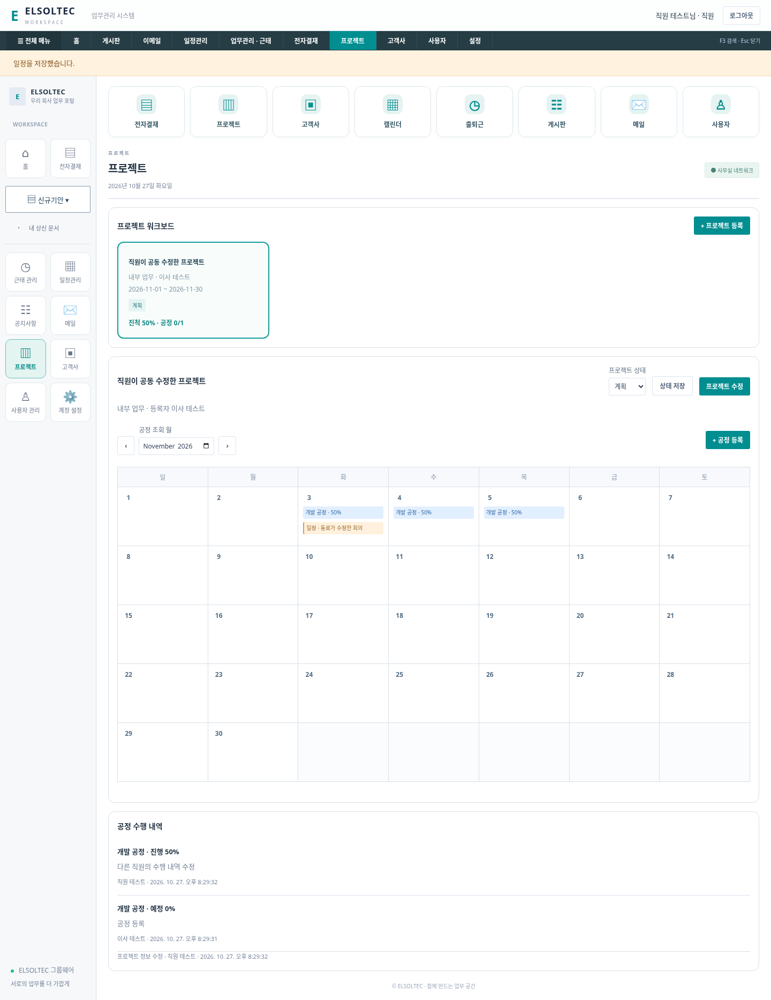
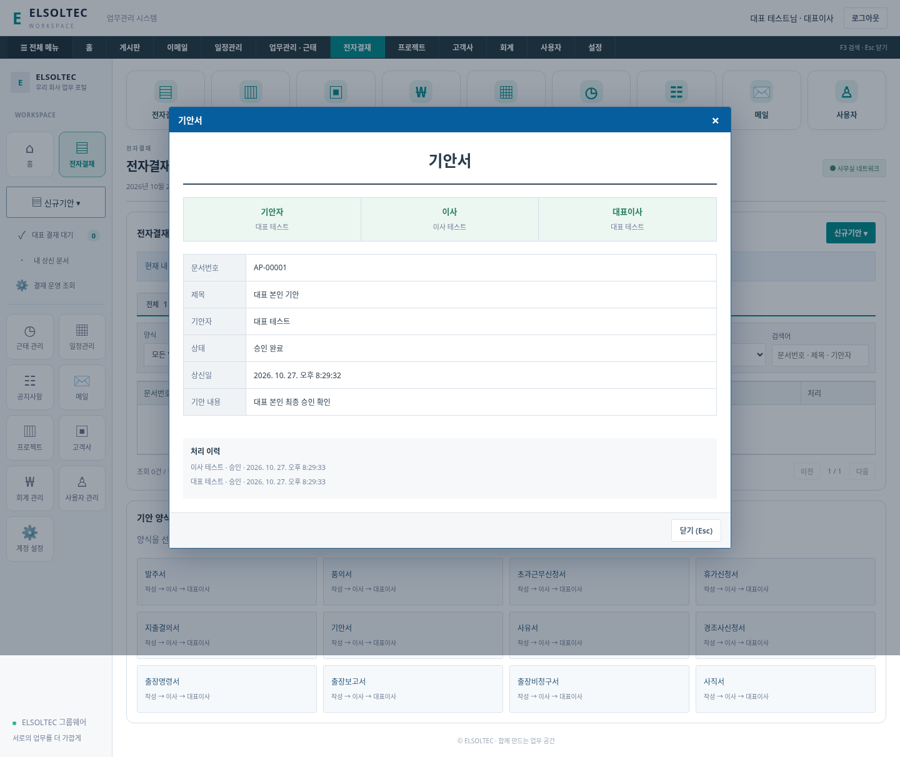

# 공동 편집·프로젝트 달력·결재 정책 변경

> 최신 공정 정책: 날짜별 완료 체크·자동 공정률·공정별 상세 이력은 [날짜별 공정 관리](PROJECT-DAILY-PROGRESS.md)를 우선 확인하세요.
## 일정 수정과 프로젝트 연결

일정관리의 항목 또는 목록의 **일정 수정**을 눌러 제목·기간·장소·설명·연결 프로젝트를 바꾸고 저장합니다. 수정 시 버전을 검사하고 변경자/내용 이력을 DB에 남깁니다.

| 일정 범위 | 내용·프로젝트 수정 | 공개 범위·참여자 변경 | 삭제 |
|---|---|---|---|
| 내 일정 | 작성자 | 작성자 | 작성자 |
| 참여자 공유 | 작성자·선택 참여자 | 작성자 또는 해당 일정을 볼 수 있는 Admin | 작성자 |
| 회사 일정 | 로그인 사용자 전체 | 작성자 또는 Admin | 작성자 |

내 일정은 다른 사람의 프로젝트 조회에도 노출되지 않습니다. 공유 일정의 비작성자는 공개 범위/참여 인원을 바꿀 수 없지만 제목·기간·내용·장소·연결 프로젝트는 수정할 수 있습니다. 기존 참여자 정보·버전 충돌 검사·승인 휴가 자동 표시도 유지합니다.

일정 작성의 **연결 프로젝트**는 등록 프로젝트 목록과 연결됩니다. 일정 목록에서 연결 프로젝트를 열 수 있고, 프로젝트 공정 달력에도 해당 사용자가 볼 수 있는 연결 일정을 함께 표시합니다. 프로젝트 이름 변경은 일정의 프로젝트 표시에 반영됩니다. 연결 해제는 프로젝트 미연결을 선택하면 됩니다.

## 프로젝트 전체 사용자 수정

모든 활성 로그인 사용자는 다른 사람이 만든 프로젝트도 수정할 수 있습니다. 프로젝트의 **프로젝트 수정**에서 이름·고객사·기간·설명·상태를 바꾸며, 공정과 담당자·진척·수행 내역도 공동 편집합니다. 등록자 정보는 유지하며 변경자와 변경 내용을 기록합니다.

동시에 수정한 이전 버전은 409로 거절하고 다시 조회하도록 안내합니다. 프로젝트 기간을 줄일 때 기존 공정이 기간 밖으로 밀려나면 거절하므로 공정을 먼저 조정해야 합니다.

## 공정 달력

기존 4열 공정 보드를 **월별 달력**으로 바꿨습니다.

1. 프로젝트를 선택하고 조회 월을 바꿉니다.
2. 날짜 또는 공정 등록을 눌러 공정명·담당자·시작일·종료일을 입력합니다.
3. 기간에 해당하는 날짜마다 공정을 표시합니다. 예정/진행/보류/완료 색상과 진척률을 확인합니다.
4. 공정 항목을 눌러 기간/담당자/진척을 바꾸고 수행 내용·변경 사유를 기록합니다.
5. 같은 달력에 연결 일정도 다른 색으로 나타나며 누르면 일정 수정창이 열립니다.

기존 주간 공정은 원래 week_start~6일 구간과 프로젝트 기간의 교집합을 시작·종료일로 설정합니다. 공정 ID·담당자·상태·진척·버전·수행 이력은 보존하고 반복 실행해도 날짜를 다시 덮어쓰지 않습니다. 과거 week_start 요청도 계속 처리하여 이전 API와 호환합니다.

## 이사 결재와 대표이사 본인 승인

1차 결재자를 화면에서 실장 대신 **이사**로 표시합니다. 기존 DB의 역할과 상태 코드 manager는 호환을 위해 유지합니다. 사용자 관리의 결재 역할 선택에서 이사(manager)를 지정하세요. Admin과 개인 프로필 직급은 여전히 별개이며, 개인이 직급을 이사/대표이사로 바꿔도 결재 권한은 생기지 않습니다.

이사 → 대표이사 순서와 직원 승인 차단을 유지합니다. **이사와 대표이사는 본인 문서의 각 해당 단계에서도 승인/반려할 수 있습니다.** 대표이사 본인 상신도 먼저 이사 승인을 거친 뒤 본인이 대표 단계의 최종 승인을 합니다. 단계 건너뛰기나 완료 문서 재승인은 차단합니다.

휴가·일반 지출·기타 기안에 동일하게 적용하고 최종 승인 지출의 회계 반영은 기존대로 한 번만 수행합니다. 기존 계정과 진행 중인 문서도 계속 사용할 수 있습니다. 계정 표시 이름은 임의로 변경하지 않습니다.

## 연구개발비 신규 양식 제거

기존 지출결의서(연구비), 요청에서 지칭한 연구개발비 양식을 신규기안·양식 카드·새 작성 선택지에서 제거했습니다. 현재 신규 양식은 **12종**이며 일반 지출결의서는 유지합니다. API에서 research_expense 신규 작성도 400으로 차단합니다.

기존 연구비 문서는 삭제하지 않습니다. 문서·과제 정보·이력·승인·회계 연결을 보존하고 기존 문서를 처리할 수 있습니다. 기존 문서가 있을 때 조회 필터에는 ‘연구개발비·기존’ 항목만 제공합니다. 새 작성 메뉴로 되돌아오지는 않습니다.

## 검증과 데이터

`npm test` **19개 통과**. 추가 테스트는 기존 주간 공정의 날짜 마이그레이션 반복 실행/보존, 다른 직원의 프로젝트·공정 수정과 감사/충돌 기록, 일정 프로젝트 연결/해제와 공동 수정, 개인 일정 비공개 유지, 대표이사 자신의 휴가·지출·기안 최종 승인, 신규 연구비 차단과 기존 문서 승인·백업을 포함합니다.

기존 3개 Chromium 검증과 새 `scripts/collaboration-smoke.mjs`가 통과했습니다. 새 검증은 직원의 프로젝트 정보/공정 수정, 일정→프로젝트 왕복 이동, 연결 일정 공동 수정, 이사 결재함 표시, 대표 자신의 최종 승인, 신규 양식 12개와 모바일 화면을 확인합니다. 실제 Windows/Edge와 운영 HTTPS 배포 검증은 아닙니다.

DB에는 schedule_events.project_id, project_tasks.start_date/end_date 및 project_changes를 추가합니다. 원본 DB·문서는 유지하며 백업에도 새 데이터가 포함됩니다. 아래 화면은 임시 검증용 계정과 자료입니다.
