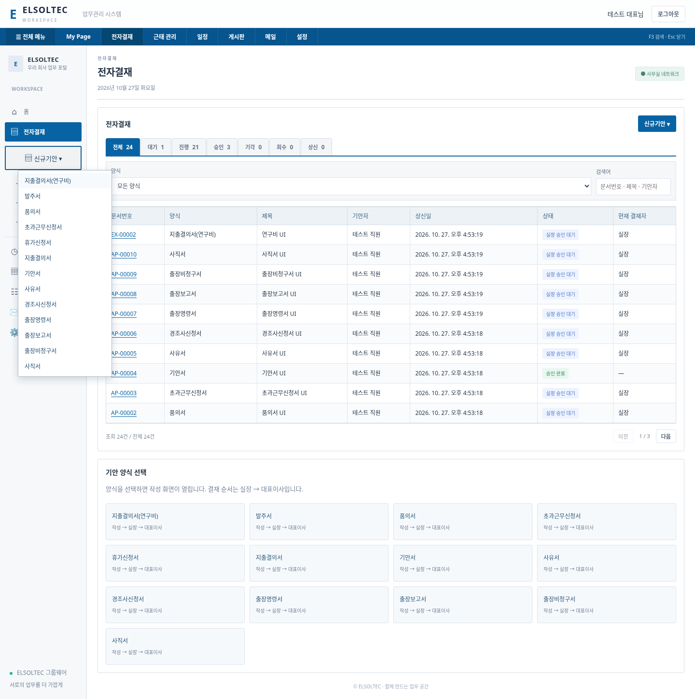

# 신규기안 메뉴와 통합 전자결재

## 참고 자료 및 확인 범위

사용자가 제공한 화면 이미지의 `전자결재 → 신규기안` 펼침 메뉴를 분석하여 아래 13개 항목과 순서를 반영했습니다.

원본과 첫 압축본 교육 영상은 32MiB 한도로 전송하지 못했지만, 이후 첨부한 `_compressed (1).mp4`(28,135,563바이트)는 정상적으로 받았습니다. 139분 46.37초 전체 시간 구간의 정지 화면과 주요 장면을 검토했습니다. [교육 영상 분석 및 최신 적용 범위](TRAINING-REVIEW.md)를 확인하세요. 원본 영상은 GitHub에 포함하지 않습니다.

아래 입력 항목은 첨부 이미지의 양식명과 기존 회사 결재 규칙을 바탕으로 만든 초기 양식입니다. 교육 영상의 서식을 그대로 복제한 것은 아닙니다.

## 양식

| 신규기안 메뉴 | 작성 항목 |
|---|---|
| 지출결의서(연구비) | 기존 지출 항목 + 연구과제명(필수), 과제번호 |
| 발주서 | 거래처, 납기일, 품목/규격/수량 내역, 발주 총액 |
| 품의서 | 목적, 내용, 예상 비용 |
| 초과근무신청서 | 근무일, 시작/종료 시각, 업무 내용 |
| 휴가신청서 | 기존 휴가 종류/기간/사유 |
| 지출결의서 | 기존 거래처/결제수단/증빙번호/항목별 금액 |
| 기안서 | 기안 내용 |
| 사유서 | 발생일, 사유 및 경위 |
| 경조사신청서 | 구분, 행사일, 관계, 신청 내용 |
| 출장명령서 | 출장 기간, 출장지, 목적, 예상 경비 |
| 출장보고서 | 출장 기간, 출장지, 결과 보고 |
| 출장비청구서 | 출장 기간, 청구 내역, 청구 총액 |
| 사직서 | 희망 퇴사일, 사유/인수인계 |

새 기안 10종에는 공통 제목이 있습니다. 초과근무는 같은 날짜 기준이며 자정을 넘으면 날짜별 신청으로 나눕니다. 숫자는 원 단위 정수, 날짜는 실제 날짜와 기간 순서를 서버에서 검증합니다.

## 사용 흐름

1. 상단 또는 좌측 `전자결재`를 엽니다.
2. 왼쪽 `신규기안`을 누르고 양식을 선택합니다. 본문의 양식 카드도 같은 기능입니다.
3. 내용을 입력해 `결재 상신`합니다.
4. 통합 결재함에서 문서번호를 눌러 내용과 처리 이력을 확인합니다.
5. 실장 → 대표이사 순차 승인. 현재 단계에서 반려할 수 있고 신청자는 실장 승인 전 회수할 수 있습니다.

통합 결재함은 휴가(LV), 지출(EX), 기타 기안(AP)을 함께 조회합니다. 양식/검색어 필터, 10건 단위 페이지, 전체·대기·진행·승인·기각·회수·상신 탭을 제공합니다. `대기`는 로그인한 사용자가 지금 승인할 수 있는 문서, `상신`은 본인이 작성한 문서입니다. `기각`은 기존 반려 상태에 대응합니다. 메뉴에 실데이터 건수를 표시합니다.

합의·시행·배포·회람·대결·전결·임의 결재선·서식 운영자 편집·증빙 파일 첨부는 구현하지 않았습니다. 행정/회계/급여/인사 시스템에 자동 반영하지 않습니다. 이미지에 보이지만 동작을 확인하지 못한 메뉴를 작동하는 것처럼 표시하지 않습니다. 실장/대표 본인 신청에 대한 기존 본인승인 차단 규칙도 유지합니다.

## 데이터 보존

approval_requests/approval_decisions 테이블을 추가하고, 기존 지출 테이블에는 form_type/project_name/project_code를 추가합니다. 이전 지출의 양식은 일반 지출로 설정합니다. 기존 계정·결재·금액·근태를 삭제하지 않습니다. 백업/복원에 새 문서와 이력도 포함됩니다. 업데이트 전 서버를 종료하고 data 폴더를 백업하세요.

## 검증

- `npm test` 12개 통과: 새 양식 검증, 10종 상신, 권한/순차승인/회수/반려, 연구비 구분, 백업/복원, 이전 지출 DB 반복 마이그레이션 포함.
- 선택적 `scripts/ui-smoke.mjs`: Chromium에서 13개 메뉴 이동, 새 양식 10종 작성·상신, 연구비 상신, 통합 결재함 필터와 실장/대표 승인, 키보드 메뉴 조작 및 모바일 가로 넘침 없음 확인.
- 실제 Windows/Edge 및 운영 배포 검증은 수행하지 않았습니다. 이후 교육 영상 검토 결과와 최신 15개 테스트는 TRAINING-REVIEW.md에 정리했습니다.

아래는 테스트용 임시 계정/문서이며 실제 회사 데이터가 아닙니다.

