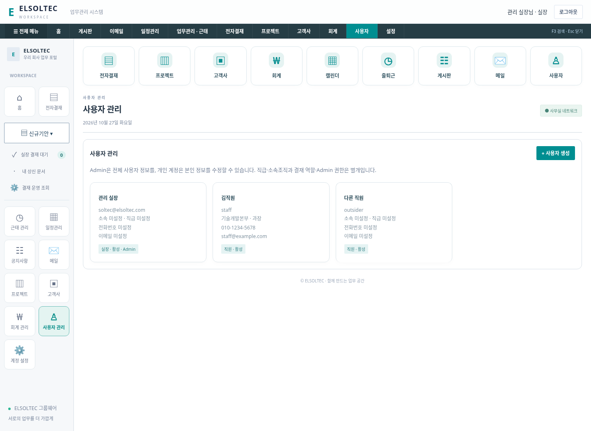
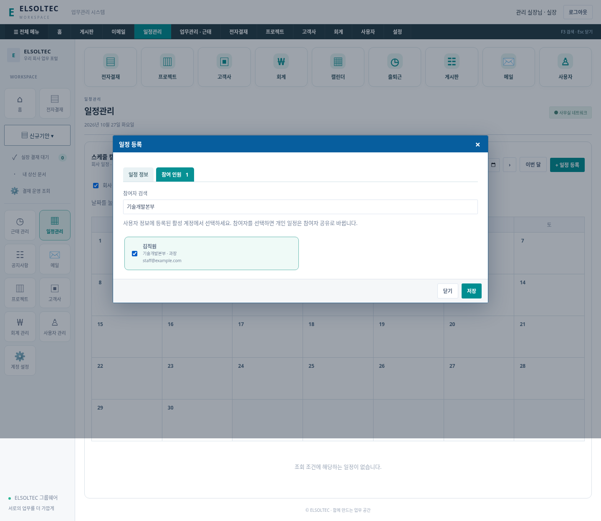

# 사용자 정보와 일정 참여 인원

> 이후 변경: 이사/대표 본인 승인, 프로젝트 전체 사용자 공동 수정, 공정 달력, 일정 공동 수정·프로젝트 연결, 연구개발비 신규 양식 제거가 적용됐습니다. [최신 정책](COLLABORATION-UPDATE.md)을 우선 확인하세요.
## 사용자 관리

### 저장 항목

- 이름
- 직급 9개: 대표이사, 이사, 본부장, 연구소장, 부장, 차장, 과장, 대리, 사원
- 소속조직 4개: 경영본부, 기업부설연구소, 사업본부, 기술개발본부
- 전화번호, 이메일

프로필의 직급/조직은 결재 역할(employee/manager/ceo)이나 Admin 권한을 자동 변경하지 않습니다. 실장 결재 역할은 manager로 계속 관리하며 직급의 9개 선택지와 별개입니다.

### 수정 범위

Admin은 사용자 관리에서 모든 계정의 프로필을 수정하고 사용자 생성·결재 역할·Admin·활성 상태·비밀번호 초기화를 관리합니다. 개인 계정은 같은 사용자 관리 메뉴에서 **본인 카드만** 보고 이름/직급/조직/전화번호/이메일을 수정합니다. 다른 사용자의 관리 데이터와 비밀번호 해시 등은 제공하지 않습니다.

본인 정보 수정 API는 role/is_admin/active/login/password 값을 받지 않습니다. 해당 필드를 섞어서 보내도 거절합니다. 개인정보 수정 후 본인 세션은 유지하며 화면이 새로고침됩니다. Admin의 계정 변경은 기존 정책대로 대상 계정을 재로그인하게 합니다. 비밀번호 변경은 기존 계정 설정에서 합니다.

사용자 생성과 개인 프로필 저장에는 위 항목을 입력해야 합니다. 이전 계정의 빈 값은 임의로 채우지 않고 보존합니다. Admin의 과거 버전 API가 프로필 필드를 생략하면 기존 값을 유지합니다. 로그인 아이디와 연락 이메일은 별개이며 프로필 이메일 수정으로 로그인 아이디를 바꾸지 않습니다.

## 일정 참여 인원

1. 일정관리 → 일정 등록을 엽니다.
2. 제목과 기간을 입력합니다.
3. **참여 인원** 탭에서 이름·직급·소속·이메일로 검색하고 체크합니다.
4. **일정 정보** 탭에서 공개 범위를 확인하고 저장합니다.

참여자는 사용자 ID로 연결합니다. 이름/직급/조직을 복사한 별도 명단이 아니므로 사용자 정보가 변경되면 기존 일정의 참여자 표시도 다음 조회 때 최신 값으로 바뀝니다. 전화번호는 참여자 선택용 디렉터리에 제공하지 않습니다.

### 공개 범위

| 범위 | 조회 가능 계정 |
|---|---|
| 내 일정 | 작성자만. 선택 인원이 있으면 참여자 공유로 전환 |
| 참여자 공유 | 작성자와 선택한 참여자 |
| 회사 일정 | 로그인한 직원 전체. 참여 인원은 별도 표시 |

선택된 참여자도 조회만 하며 작성자만 일정과 참여자를 변경/삭제할 수 있습니다. 개인 일정으로 되돌리려면 참여 인원을 해제합니다. 캘린더의 **초대 일정** 필터로 참여자 공유 일정을 표시/숨길 수 있습니다. 승인된 휴가는 기존처럼 자동 표시하고 사유는 공유하지 않습니다.

활성 사용자만 새로 선택할 수 있습니다. 나중에 비활성화된 기존 참여자는 과거 일정에 남겨 표시하고, 작성자가 제거할 수 있습니다. 새 일정에 비활성 사용자를 넣는 요청은 거절합니다. 비활성 계정의 로그인 자체도 기존 정책에 따라 차단됩니다.

이메일 초대, 푸시 알림, 참석 수락/거절, 반복 일정은 구현하지 않았습니다.

## 데이터·검증

users에 job_title/organization/phone/email 열을 추가하고 schedule_participants 관계 테이블을 생성합니다. 기존 사용자·Admin·일정·결재·업무 데이터는 삭제하지 않습니다. 참여자 관계와 프로필은 SQLite 백업에 포함되며 복원 시 세션 종료 정책도 유지합니다.

자동 테스트 **17개 통과**. 신규 테스트는 정확한 9개 직급/4개 조직, 값 검증, 본인 전용 조회/수정, 권한 상승 시도 차단, 참여자·비참여자별 접근, 프로필 갱신 연동, 비활성 참여자 처리, 참여자 제거, 백업/복원을 검증합니다.

Chromium 검증(`scripts/profile-smoke.mjs`)에서 Admin 정보 수정, 개인 정보 수정(권한 입력란 없음), 참여자 검색·선택·범위 자동 전환, 참여자 캘린더 표시/수정 불가, 비참여자 격리, 모바일 화면을 확인했습니다. 기존 `ui-smoke.mjs`와 `business-smoke.mjs`도 통과했습니다. 화면 데이터는 임시 테스트 자료입니다. 실제 Windows/Edge 및 운영 배포 검증은 별도입니다.
