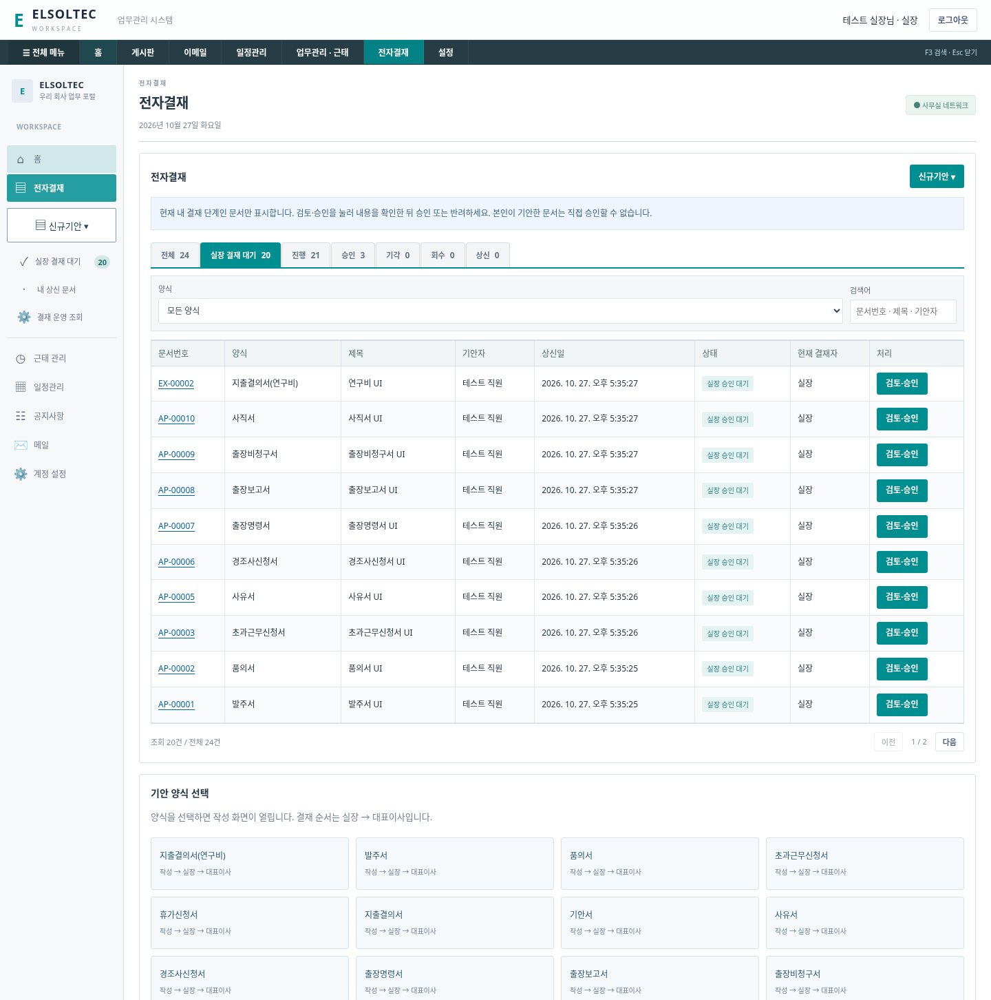
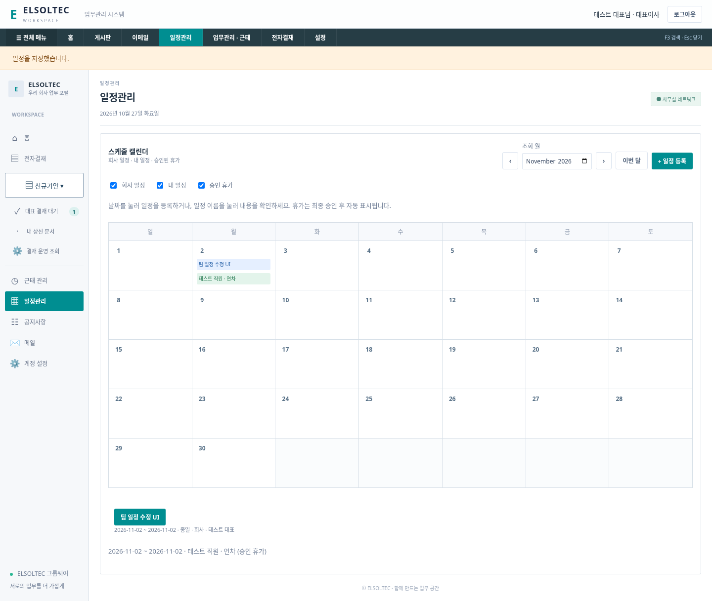

# 전자결재 운영자 교육 영상 분석과 적용


> 최신 변경: 실장 본인 승인을 허용하고 Admin·프로젝트·고객사·회계를 추가했습니다. 이전 구현 시점 설명과 다를 수 있으므로 [최신 업무 보드 문서](BUSINESS-BOARD.md)를 우선 확인하세요.
## 영상 확인 범위

최종 첨부 파일: `[전자결재 운영자 교육(기본편)] - 풀버전(140분)_compressed (1).mp4`.

- 파일 크기 28,135,563바이트, 길이 8,386.37초(139분 46.37초), 522×360.
- 파일에는 영상 스트림만 있고 음성 트랙이 없습니다. 음성 교육 내용을 전사하거나 확인할 수 없습니다.
- 전체 시간 구간을 3분 간격으로 샘플링한 약 47개 화면과 2/5/8/14/26/43/50/57/68/80/90/102/113/128/137분의 정지 화면을 확인했습니다. 140분을 연속 재생하며 모든 클릭을 검증한 것은 아닙니다.
- 이전 원본과 첫 압축본은 전송 제한으로 열지 못했으나 최종 압축본은 정상 분석했습니다. 해상도가 낮아 작은 옵션 문구나 시연 중 입력값을 모두 읽을 수는 없습니다. 판독 가능한 제목·메뉴·도표와 화면 구조를 기준으로 아래를 정리했습니다.
- 원본 영상, 교육 화면 및 교육 사이트 자료는 배포 저장소에 넣지 않습니다. 아래 앱 화면은 별도 임시 테스트 데이터입니다.

## 시간대별 관찰

| 구간(약) | 확인한 내용 | 반영 |
|---|---|---|
| 0–12분 | 결재 프로세스 개요, 승인/반려, 회수와 취소 구분 | 결재 대기함·진행·완료 분리, 현재 단계 승인, 기존 회수 규칙 유지 |
| 13–29분 | 선결재/후결, 대결/후열, 전결, 확인/감사, 합의 설명 | 회사에서 확정한 실장→대표 순차 결재와 구분. 미구현 기능을 동작한다고 표시하지 않음 |
| 30–54분 | 핵심 용어 요약, 전자결재 주요 운영 메뉴 | 사용자 업무와 운영 조회를 분리, 메뉴별 구현 상태 아래에 기재 |
| 55–90분 | 운영자 웹 화면, 양식 등록/옵션·문서번호·프로세스·문서 열람 규칙 | 권한별 대기함을 서버에서 조회, 본인 문서 승인 차단, 문서 접근 범위 유지 |
| 91–110분 | 양식 구성, 기본/고급 컴포넌트, 양식 편집기 | 13개 업무 양식의 입력 폼과 결재 문서 상세를 유지. 자유 편집기는 미구현 |
| 111–139분 | 양식 샘플 활용, 다른 양식 불러오기, 엑셀/워드 양식 활용과 예제 | 양식 선택→작성→상신 흐름을 유지. 외부 파일의 양식 자동 변환 기능은 미구현 |

교육 영상은 다우오피스 전자결재의 **운영자 교육**으로, 일반 사용자의 게시판·웹디스크·캘린더 전체를 시연하는 영상은 아닙니다. 스케줄 캘린더는 사용자의 별도 요구에 따라 구현했습니다.

## 영상에 보이는 주요 운영 메뉴와 현재 상태

43분/50분의 주요 메뉴 설명 표에서 다음 14개 항목을 확인했습니다.

| 교육 메뉴 | 현재 시스템 적용 상태 |
|---|---|
| 결재양식관리 | 신규기안 13종과 읽기 전용 양식 목록. 운영자 양식 편집기는 없음 |
| 전자결재설정 | 현재 순차 결재·본인 승인 차단·회수 시점을 운영 조회에서 확인. 규칙 수정 화면은 없음 |
| 문서함 폴더 설정 | 전체/대기/진행/승인/기각/회수/상신 상태 탭. 사용자 폴더 편집은 없음 |
| 자동결재선설정 | 고정 실장→대표이사만 적용. 조건별 자동 결재선은 없음 |
| 전사문서함관리 | 실장/대표 권한으로 현재 결재 문서 조회. 별도 전사 보존 문서함은 없음 |
| 부서문서함관리 | 부서 모델 및 문서함은 미구현 |
| 공문발송설정 | 미구현. 카페24 웹메일 링크와 별개 |
| 결재관리자설정 | 로컬 운영자 CLI 계정 역할 설정 지원. 웹 관리자는 미구현 |
| 서명 인증 등록 | 전자서명 인증/직인 이미지는 미구현 |
| 전자결재 문서번호 설정 | LV/EX/AP 고정 번호. 번호 규칙 편집은 미구현 |
| 결재문서관리 | 현재 통합 조회·검색·처리 이력 및 운영 현황 조회. 별도 문서 이관은 없음 |
| 보안등급관리 | 역할/소유자 서버 권한 적용. 다단계 보안 등급 설정은 미구현 |
| 전자결재 양식별 통계 | 사용자 상태 건수와 운영 화면의 휴가/지출/기타 기안 현황. 세부 양식 통계 편집 화면은 없음 |
| 전자결재 부서별 통계 | 부서 모델이 없어 미구현 |

이 목록은 교육에서 확인한 메뉴의 분석 결과이며, 14개 메뉴의 전체 기능을 구현했다는 뜻이 아닙니다. 미구현 메뉴를 작동하는 것처럼 넣지 않고, 현재 작동하는 메뉴만 앱에 연결합니다.

## 이번 요청 반영

### 메뉴와 실장 승인

상단을 홈·게시판·이메일·일정관리·업무관리/근태·전자결재·설정으로 구성하고 교육 플랫폼의 짙은 모듈 바와 청록 강조색을 반영했습니다. ELSOLTEC 이름과 자체 화면은 유지합니다.

왼쪽의 **휴가신청서·지출결의서 바로가기를 제거**했습니다. 이 두 양식과 연구비 지출은 `전자결재 → 신규기안` 안에서 계속 선택할 수 있습니다. 문서가 삭제된 것이 아닙니다.

실장(manager)은 **실장 결재 대기** 버튼/탭에서 서버가 허용한 현재 실장 단계의 휴가·지출·기안 문서를 조회합니다. 문서의 `검토·승인`을 누르고 내용 확인 후 승인/반려합니다. 승인 후 대표 대기함으로 넘어갑니다. 대표(ceo)는 대표 결재 대기함을 사용합니다. 직원(employee)은 해당 승인 대기 API에 접근할 수 없습니다. 본인 기안은 직접 승인할 수 없습니다.

`결재 운영 조회`는 실장/대표만 사용하는 읽기 전용 규칙·양식·문서 현황 화면입니다. 사용자 역할을 웹 요청으로 바꿀 수 없습니다.

기존 실장 계정이면 재생성할 필요 없습니다. 실수로 직원 역할로 만든 경우 서버를 종료하고 운영자 PowerShell에서 아래를 실행한 뒤 재시작/재로그인합니다. 회사 정책에 따른 서버 운영자만 실행하세요.

```powershell
node server.js user:role soltec@elsoltec.com manager
```

역할 변경 시 해당 계정의 세션은 모두 종료됩니다. 비밀번호와 기존 기록은 유지합니다.

### 스케줄 캘린더

- 개인/회사 일정 등록·수정·삭제, 종일 또는 한국 시간대 시작/종료 시각, 장소·설명.
- 개인 일정은 본인만, 회사 일정은 로그인 직원에게 공개. 작성자만 변경 가능.
- 최종 승인된 휴가 자동 표시. 신청 사유는 공유하지 않고 승인 전/반려/회수 문서는 제외.
- 이전/다음 달·이번 달, 종류별 표시 필터, 날짜 클릭 등록, 일정 클릭 상세/수정.
- 휴가는 캘린더에서 임의 수정하지 않고 결재 데이터에서 가져옵니다.
- 수정 버전을 검사하여 다른 창의 오래된 내용이 덮어쓰지 않도록 합니다. 삭제 이력도 DB에 남깁니다.
- 실시간 푸시·반복 일정·회의실 예약·초대 알림은 아직 없습니다. 다른 화면에서 승인한 뒤 캘린더로 이동하면 최신 휴가를 조회합니다.

## 데이터 및 검증

기존 data/group.db에 schedule_events/schedule_changes 테이블만 추가합니다. 기존 문서와 계정을 삭제하지 않습니다. 백업/복원에 일정과 변경 이력도 포함됩니다.

자동 테스트 **15개 통과**. 실장/대표 대기함 서버 권한과 단계 이동, 역할 변경 시 세션 종료, 개인 일정 격리, 회사 일정 조회, 작성자 권한, 버전 충돌, 삭제, 월 경계 일정/휴가, 사유 비공개 및 백업/복원을 포함합니다.

Chromium 검증에서는 신규기안 13종, 기존 양식 상신과 승인, 왼쪽 바로가기 제거, 실장 대기함과 운영 조회, 캘린더 등록/수정/삭제/휴가 필터 및 모바일 너비에서 가로 넘침 없음을 확인했습니다. 실제 Windows/Edge 및 운영 HTTPS 배포 검증은 아닙니다.




