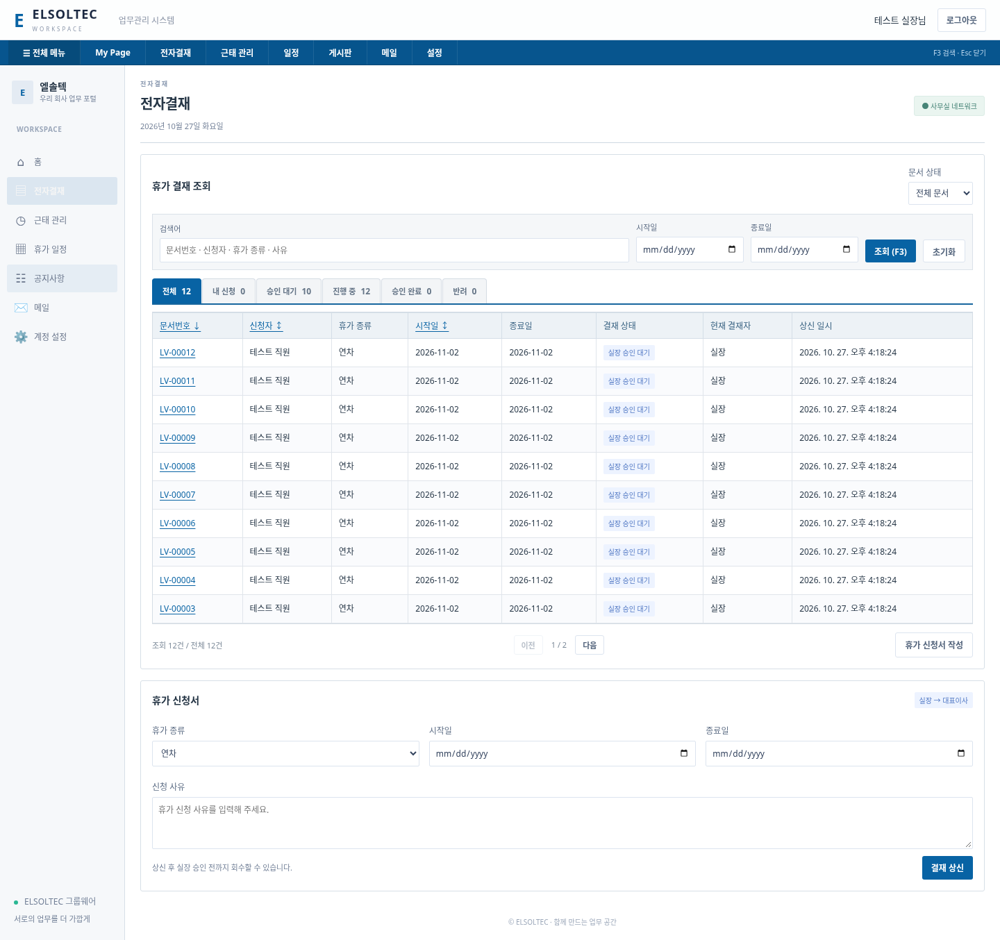
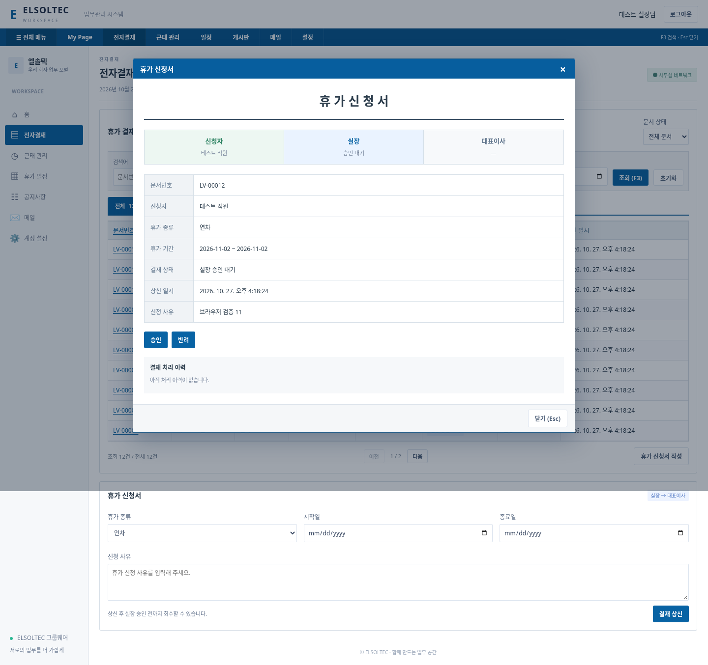
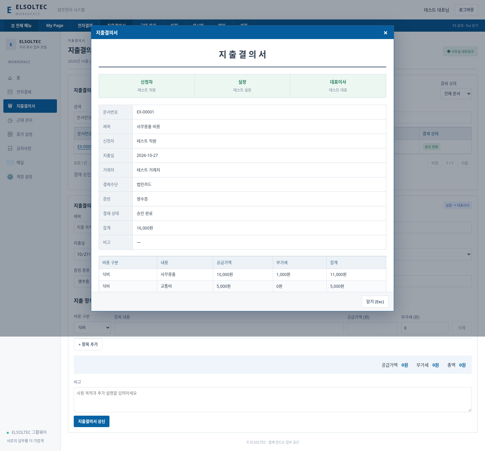

# 첨부 영상 분석과 UI 적용

> 최신 변경: 실장 본인 승인을 허용하고 Admin·프로젝트·고객사·회계를 추가했습니다. 이전 구현 시점 설명과 다를 수 있으므로 [최신 업무 보드 문서](BUSINESS-BOARD.md)를 우선 확인하세요.
분석 자료: 사용자가 첨부한 `모든기능 l 이카운트 ERP.mp4`.
길이 약 74.62초, 화면 1280×720. 전체 구간을 3초 간격으로 추출한 25개 장면과 주요 메뉴·보고서·입력·상세 구간의 원본 크기 정지 화면을 검토했습니다. 아래는 영상에 보이는 화면 기준 분석이며 음성 전사나 제품 전체 기능 명세가 아닙니다. 원본 영상은 프로젝트나 GitHub에 포함하지 않습니다.

| 영상 구간(약) | 화면에서 확인한 구성 | ELSOLTEC에 적용한 내용 |
|---|---|---|
| 6–12초 | 상단 모듈, 왼쪽 분류, 여러 열로 펼쳐지는 메뉴, 관리/근태 분류 | 상단 업무 메뉴와 5열 전체 메뉴, 업무별 이동 |
| 14–25초 | 재고·거래처·판매 보고서, 작은 행 높이, 선으로 나뉜 표, 열 제목 | 결재·근태를 촘촘한 조회 표로 변경, 클릭 가능한 문서번호 |
| 26–33초 | 목록과 입력 화면, 검색·옵션, 탭과 강조된 입력 구역 | 결재 검색어·기간 조건, 상태 탭, 신청서 구역, 상세창 |
| 35–40초 | 무료 부가 서비스 안내 | UI로 추가하지 않음. 결제·쇼핑몰·재고 연동이 구현된 것처럼 표시하지 않음 |
| 41–52초 | 입출금 조회, 조건 팝업, 문서 진행 단계, 하단 실행 버튼 | 문서 상세 팝업, 신청자→실장→대표이사 단계 표시, 승인·반려·이력 |
| 55–64초 | 별도 포털 로그인, 포털 목록, 모바일 조회 화면 | 기존 자체 로그인 유지, 작은 화면에서는 표 안 가로 스크롤과 메뉴 재배치 |

## 구현한 동작

- 전체 메뉴는 실제 사용 가능한 기능만 연결합니다. 메뉴 클릭 후 팝업은 닫힙니다.
- 문서 검색: 문서번호(LV-00001 등), 신청자, 휴가 종류, 신청 사유. 입력 후 조회를 누릅니다.
- 기간 조건은 휴가 기간과의 겹침으로 조회합니다. 시작일이 종료일보다 늦으면 안내합니다.
- 상태 탭: 전체/내 신청/승인 대기/진행 중/승인 완료/반려. 수치는 로그인 사용자에게 API가 허용한 문서에서 계산합니다.
- 정렬: 문서번호·신청자·시작일 열 제목 클릭. 기본 최신 문서번호 순서.
- 한 페이지 10건, 이전/다음 및 조회 건수 표시.
- 문서번호 클릭: 문서 내용·승인 단계·처리 이력. 현재 승인 권한이 있을 때만 승인/반려 버튼 표시. 최종 검사는 서버에서 수행합니다.
- F3: 결재 조회를 열고 검색어 입력란으로 이동. 팝업이 열려 있으면 적용하지 않습니다. Esc: 팝업 닫기.
- 기존 계정·DB·결재 흐름·사무실 IP 제한·공지·달력·CSV·웹메일 연결은 유지합니다. 2단계 인증은 사용하지 않습니다.

## 이번 범위 밖

영상의 재고·영업·생산·회계·세무·급여 전체를 구현한 것은 아닙니다. UI와 기존 그룹웨어 업무 흐름을 맞추는 변경입니다. 카페24 메일도 웹메일 연결이며 그룹웨어 내부 송수신은 구현하지 않았습니다. 원본의 상표·로고·자료·샘플 거래 내역은 사용하지 않았습니다.

## 검증

`npm test`: 기존 API·권한·백업 등 7개 테스트 통과.

추가 Chromium 검증(`scripts/ui-smoke.mjs`): 별도 임시 DB에 12개 신청서를 생성하고 전체 메뉴, 상태 조회, 10건/2건 페이지 분리, 검색, 문서 상세, 실장 승인, 대표 승인 API, 출근 등록, 공지, 홈 갱신, F3/Esc를 확인했습니다. 너비 390px에서 페이지 및 전체 메뉴 가로 넘침 없음과 JavaScript 오류 없음을 확인했습니다. 실제 Edge/Windows 실행 검증은 아닙니다.

브라우저 검증은 선택 사항입니다. 개발 환경에 Playwright와 Chromium을 설치한 후 `node scripts/ui-smoke.mjs`를 실행합니다. 필요한 경우 PLAYWRIGHT_MODULE에 Playwright 모듈 경로(index.mjs), BROWSER_EXECUTABLE에 Chromium 실행 파일 경로를 지정합니다. UI_SCREENSHOT_DIR을 지정하면 그 폴더에 화면 예시를 저장합니다. 테스트 데이터는 임시 경로에서만 생성·삭제하며 운영 data 폴더를 변경하지 않습니다.

## 화면 예시

아래 데이터는 브라우저 검증용 임시 계정과 문서이며 실제 회사 데이터가 아닙니다.

## 추가 재생목록 분석 상태

추가 자료: https://www.youtube.com/playlist?list=PLacuwcWDJIcIbq7A8FYl2p4aNcvoh8i9a

개발 환경에서 재생목록 HTTPS 요청이 `Tunnel connection failed: 403 Forbidden`으로 차단되었습니다. 따라서 목록의 영상 수·제목·개별 화면을 확인하지 못했으며, 모든 영상을 시청·분석했다는 주장을 하지 않습니다. 재생목록 기반 전체 재구성은 미완료입니다. 사용자의 영상 파일 첨부가 필요합니다.

이번 독립 변경은 회사명 ELSOLTEC 표기 및 지출결의서 추가입니다. 기존 첨부 영상의 표/팝업/결재 흐름을 유지했으며, 접근하지 못한 재생목록에서 가져온 기능이라고 표시하지 않습니다.

### 지출결의서 화면

검증용 임시 계정과 지출 데이터입니다.

